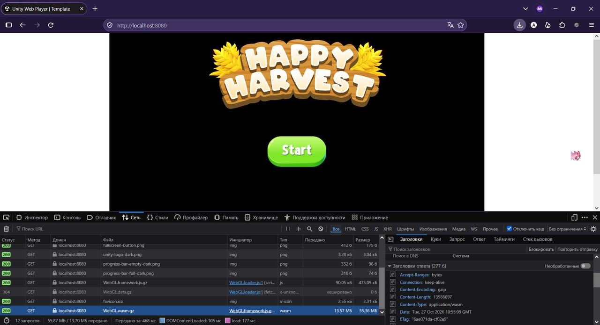
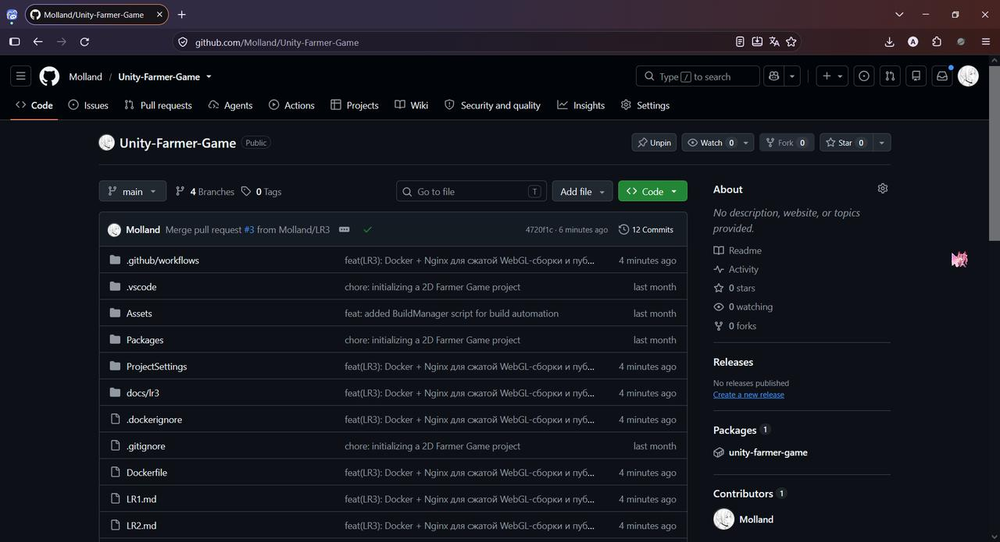
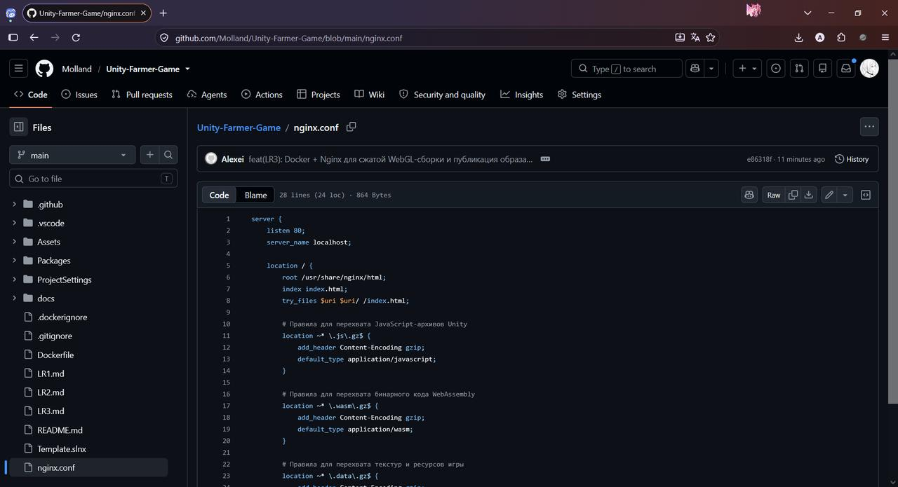
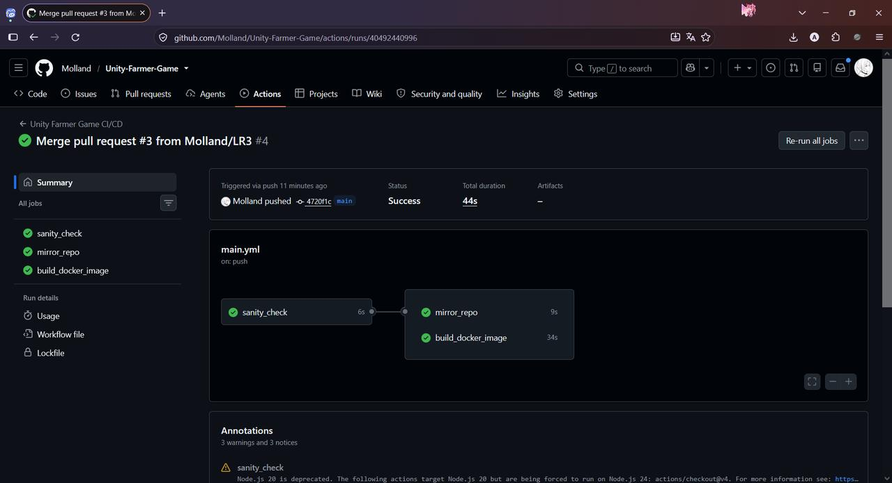
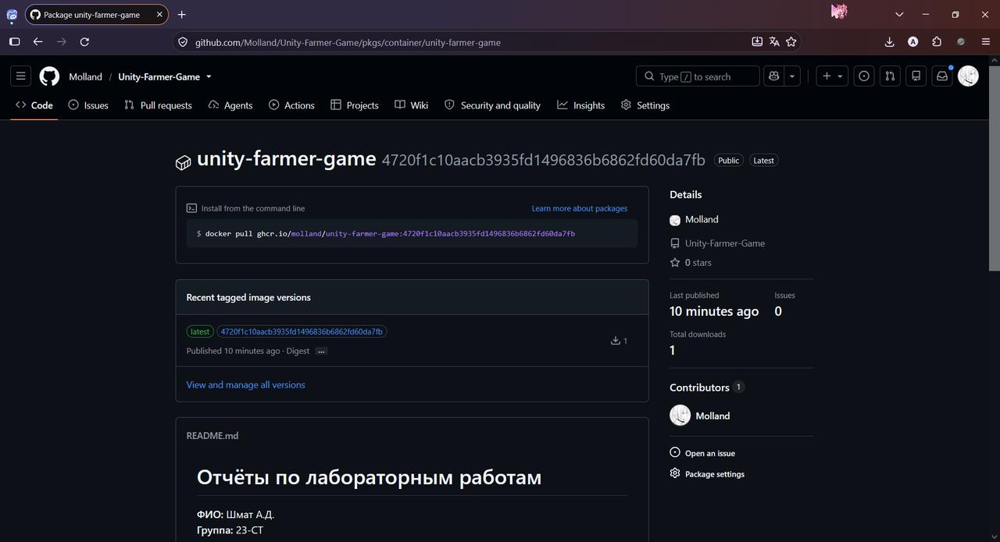
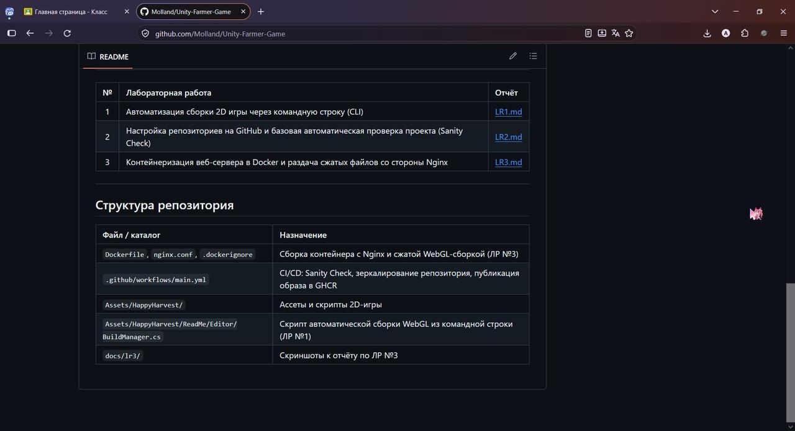

# Лабораторная работа №3: Контейнеризация веб-сервера в Docker и раздача сжатых файлов со стороны Nginx

**ФИО:** Шмат А.Д.  
**Группа:** 23-СТ

---

## Шаг 1 — Настройка сжатия в Unity 6 и локальная пересборка

В окне `File → Build Profiles → Player Settings → Player → WebGL → Publishing Settings` параметр **Compression Format** переключён со значения `Disabled` на **Gzip**, а галочка **Decompression Fallback** снята — распаковкой занимается браузер, а не JS-распаковщик на стороне клиента.

После сохранения настроек проект пересобран из командной строки командой из ЛР №1. В папке `Builds/WebGL/Build/` архивы получили расширения `.gz`:

```text
Builds/WebGL/Build/
├── WebGL.data.gz          18 725 779 байт
├── WebGL.framework.js.gz      89 769 байт
├── WebGL.loader.js            26 983 байт
└── WebGL.wasm.gz          13 566 697 байт
```

---

## Шаг 2 — Создание конфигурации веб-сервера `nginx.conf`

Кастомный конфигурационный файл заставляет Nginx принудительно подставлять правильные типы контента и заголовки сжатия, потому что «из коробки» легковесные серверы не умеют обрабатывать специфическую структуру архивов Unity 6:

```nginx
server {
    listen 80;
    server_name localhost;

    location / {
        root /usr/share/nginx/html;
        index index.html;
        try_files $uri $uri/ /index.html;

        # Правила для перехвата JavaScript-архивов Unity
        location ~* \.js\.gz$ {
            add_header Content-Encoding gzip;
            default_type application/javascript;
        }

        # Правила для перехвата бинарного кода WebAssembly
        location ~* \.wasm\.gz$ {
            add_header Content-Encoding gzip;
            default_type application/wasm;
        }

        # Правила для перехвата текстур и ресурсов игры
        location ~* \.data\.gz$ {
            add_header Content-Encoding gzip;
            default_type application/octet-stream;
        }
    }
}
```

---

## Шаг 3 — Создание файла `Dockerfile` с подменой слоёв

`Dockerfile` удаляет стандартные настройки Nginx и копирует на их место кастомные, а затем кладёт сжатую сборку игры в веб-каталог сервера:

```dockerfile
# Шаг 1: Берем официальный ультра-легкий веб-сервер Nginx на базе Alpine Linux
FROM nginx:alpine

# Шаг 2: Удаляем дефолтный файл настроек Nginx, блокирующий работу архивов
RUN rm /etc/nginx/conf.d/default.conf

# Шаг 3: Копирование кастомного nginx.conf внутрь системных папок сервера
COPY nginx.conf /etc/nginx/conf.d/

# Шаг 4: Очищаем стандартную веб-папку и копируем туда файлы сжатой игры из ЛР №1
RUN rm -rf /usr/share/nginx/html/*
COPY Builds/WebGL/ /usr/share/nginx/html/

# Шаг 5: Объявляем рабочий порт контейнера
EXPOSE 80

# Шаг 6: Запускаем Nginx в режиме постоянного процесса (демона)
CMD ["nginx", "-g", "daemon off;"]
```

Дополнительно добавлен файл `.dockerignore`: без него демон Docker на каждый `docker build` пересылал бы в контекст сборки ~5 ГБ (одна только папка `Library` весит 4,7 ГБ), хотя образу нужны лишь `nginx.conf` и `Builds/WebGL/`.

---

## Шаг 4 — Локальное тестирование контейнера

```console
$ docker build -t platformer-compressed:v1 .
#11 naming to docker.io/library/platformer-compressed:v1 done

$ docker run -d -p 8080:80 --name unity_compressed_container platformer-compressed:v1
86b055547ba9235c7ae2005faa6a3d3c142bb58080b4b24d68a37cf7b64e57b0

$ docker ps
NAMES                        STATUS        PORTS
unity_compressed_container   Up 3 seconds  0.0.0.0:8080->80/tcp

$ curl -sI http://localhost:8080/Build/WebGL.wasm.gz
HTTP/1.1 200 OK
Server: nginx/1.31.8
Content-Type: application/wasm
Content-Length: 13566697
Content-Encoding: gzip
Accept-Ranges: bytes
```

Игра успешно загрузилась по адресу `http://localhost:8080`, а в инструментах разработчика браузера (F12 → вкладка «Сеть» → файл `WebGL.wasm.gz` → «Заголовки») виден заголовок `Content-Encoding: gzip`:

### Скриншот — DevTools с заголовком `Content-Encoding: gzip`



После проверки тестовый контейнер остановлен:

```console
$ docker stop unity_compressed_container && docker rm unity_compressed_container
```

---

## Шаг 5 — Модернизация облачного пайплайна в GitHub Actions

В `.github/workflows/main.yml` добавлен третий этап пайплайна с поддержкой GitHub Packages (GHCR). Так как папка `Builds/` отсечена файлом `.gitignore`, пайплайн сам создаёт временные «фейковые» файлы-заглушки с расширением `.gz` — иначе шаг `COPY` в `Dockerfile` упал бы на раннере:

```yaml
  # ЗАДАЧА 3: Автоматическая сборка Docker-образа в облако
  build_docker_image:
    needs: sanity_check
    if: github.repository == 'Molland/Unity-Farmer-Game'
    runs-on: ubuntu-latest
    permissions:
      contents: read
      packages: write
    steps:
      - name: Checkout code
        uses: actions/checkout@v4

      - name: Create Compressed Placeholders for Docker
        run: |
          mkdir -p Builds/WebGL/Build
          if [ -z "$(ls -A Builds/WebGL/Build)" ]; then
            echo "<h3>Unity 6 Compressed Game Cloud Layer</h3>" > Builds/WebGL/index.html
            touch Builds/WebGL/Build/game.framework.js.gz
            touch Builds/WebGL/Build/game.wasm.gz
            touch Builds/WebGL/Build/game.data.gz
            echo "Создана временная структура сжатых файлов для сборщика Docker."
          fi

      - name: Log in to GitHub Container Registry
        uses: docker/login-action@v3
        with:
          registry: ghcr.io
          username: ${{ github.actor }}
          password: ${{ secrets.GITHUB_TOKEN }}

      - name: Build and Push Compressed Docker Image
        uses: docker/build-push-action@v5
        with:
          context: .
          file: ./Dockerfile
          push: true
          tags: |
            ghcr.io/molland/unity-farmer-game:latest
            ghcr.io/molland/unity-farmer-game:${{ github.sha }}
```

---

## Шаг 6 — Отправка изменений в облако

Файлы `Dockerfile`, `nginx.conf`, `.dockerignore` и обновлённый пайплайн отправлены в GitHub в ветке `LR3`, после проверки слиты в `main`.

---

## Шаг 7 — Проверка результатов и отчёт

### Скриншот — Файлы `Dockerfile`, `nginx.conf` и пайплайн в основном репозитории

В корне репозитория появились `.dockerignore`, `Dockerfile`, `nginx.conf`, отчёты `LR1.md`, `LR2.md`, `LR3.md`, каталог `docs/lr3/` со скриншотами и обновлённый пайплайн в `.github/workflows/main.yml`. На верхней строке — зелёная галочка успешного прохождения CI у merge-коммита из ветки `LR3`; в боковой панели виден связанный пакет `unity-farmer-game`.



### Скриншот — Содержимое `nginx.conf`

Дерево файлов слева и правила `add_header Content-Encoding gzip;` для `.js.gz`, `.wasm.gz` и `.data.gz` в правой части.



### Скриншот — Полностью зелёный статус всех трёх задач во вкладке Actions

Запуск рабочего процесса `Unity Farmer Game CI/CD` завершился со статусом **Success** за 44 секунды; все три задачи — `sanity_check`, `mirror_repo` и `build_docker_image` — отмечены зелёными галочками.



### Скриншот — Готовый пакет в GitHub Container Registry

Публичный пакет `unity-farmer-game`, привязанный к репозиторию `Unity-Farmer-Game`, опубликован под тегами `latest` и `4720f1c10aacb3935fd1496836b6862fd60da7fb` (ревизия коммита). Получить образ можно командой `docker pull ghcr.io/molland/unity-farmer-game:latest`.



### Скриншот — Главный `README.md` с таблицей ссылок на отчёты

Отчёт разделён на три файла — [LR1.md](LR1.md), [LR2.md](LR2.md) и [LR3.md](LR3.md); ссылки на них и описание структуры репозитория собраны в [README.md](README.md).



---

## Контрольные вопросы

### 1. Какую техническую проблему решает добавление строки `add_header Content-Encoding gzip;` в конфигурацию Nginx?

Unity 6 упаковывает тяжёлые компоненты игры в архивы Gzip, и файлы отдаются сервером уже сжатыми. Сам по себе файл `.wasm.gz` не является валидным WebAssembly-модулем: это gzip-поток. Если сервер не сообщает браузеру, что тело ответа сжато, браузер считает содержимое «сырым» файлом, пытается разобрать его как обычный `.wasm` и падает с ошибкой вида `Unable to parse…`.

Строка `add_header Content-Encoding gzip;` добавляет в HTTP-ответ заголовок, который говорит браузеру: «содержимое сжато алгоритмом gzip». Браузер распаковывает его нативно, силами сетевого стека, без JS-распаковщика на стороне клиента. Именно поэтому в Шаге 1 снимается галочка `Decompression Fallback`: распаковка полностью перекладывается на веб-сервер и браузер.

### 2. Почему в рамках текущей лабораторной работы в облачном пайплайне пришлось использовать генерацию временных файлов через команду `touch Builds/WebGL/Build/game.wasm.gz`?

На серверах GitHub (раннерах) нет ни установленной Unity, ни скомпилированной игры: облачный Unity-компилятор подключается только в ЛР №4. Кроме того, папка `Builds/` отсечена файлом `.gitignore`, поэтому она вообще не попадает в репозиторий — в облако уходит только исходный код.

При этом `Dockerfile` содержит инструкцию `COPY Builds/WebGL/ /usr/share/nginx/html/`, а шаг `COPY` в Docker падает с ошибкой, если источник не существует. Поэтому пайплайн сначала проверяет, пуста ли папка `Builds/WebGL/Build`, и при необходимости создаёт структуру каталогов и пустые файлы-заглушки с нужными расширениями (`.framework.js.gz`, `.wasm.gz`, `.data.gz`) через `touch`. Это позволяет Docker-инструментам успешно завершить сборку образа и проверить всю цепочку доставки до подключения настоящей сборки игры в ЛР №5.

### 3. В какую директорию внутри контейнера Nginx необходимо копировать финальные скомпилированные файлы WebGL-игры согласно официальной документации образа?

В корень веб-каталога Nginx — `/usr/share/nginx/html`. Это стандартный `root`, из которого официальный образ `nginx:alpine` раздаёт статику, и именно его использует `nginx.conf` (`root /usr/share/nginx/html;`). Поэтому в `Dockerfile` сначала очищается содержимое этой папки (`RUN rm -rf /usr/share/nginx/html/*`), а затем туда копируется вся сборка: `COPY Builds/WebGL/ /usr/share/nginx/html/`.

### 4. Зачем публиковать готовый образ в реестр GHCR под двумя тегами (`latest` и `github.sha`)?

Оба тега решают разные задачи:

- **`latest`** — «плавающий» указатель на последнюю версию. По нему удобно быстро получить свежий образ (`docker pull ghcr.io/molland/unity-farmer-game:latest`), не разыскивая хеш коммита.
- **`${{ github.sha }}`** — жёсткая привязка образа к конкретному коммиту. Хеш коммита уникален и неизменен, поэтому такой тег даёт воспроизводимость: всегда можно понять, из какого именно состояния кода собран образ, а также откатиться на конкретную сборку, если новая версия окажется сломанной. Именно этот тег делает образ переносимым и версионируемым артефактом доставки.
