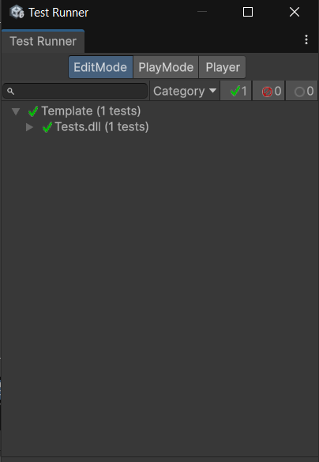
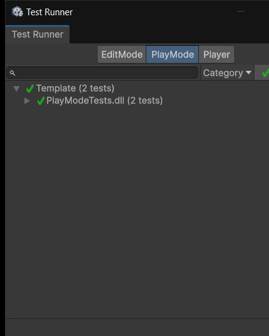
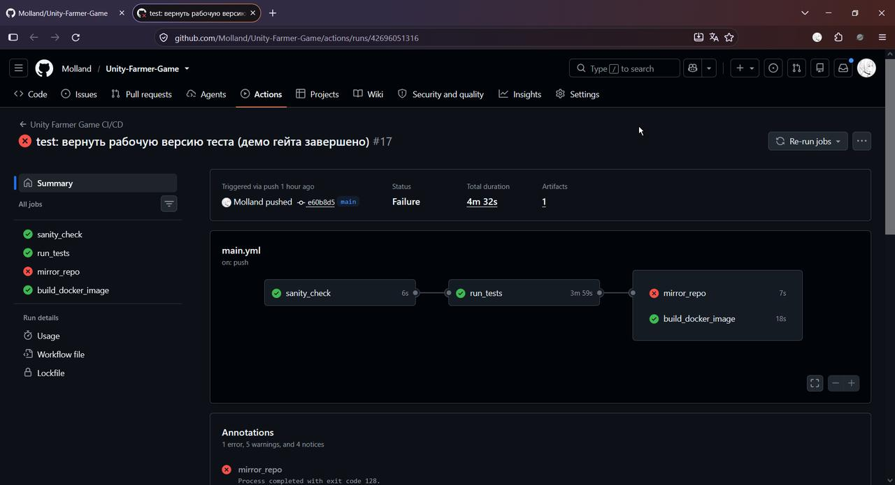
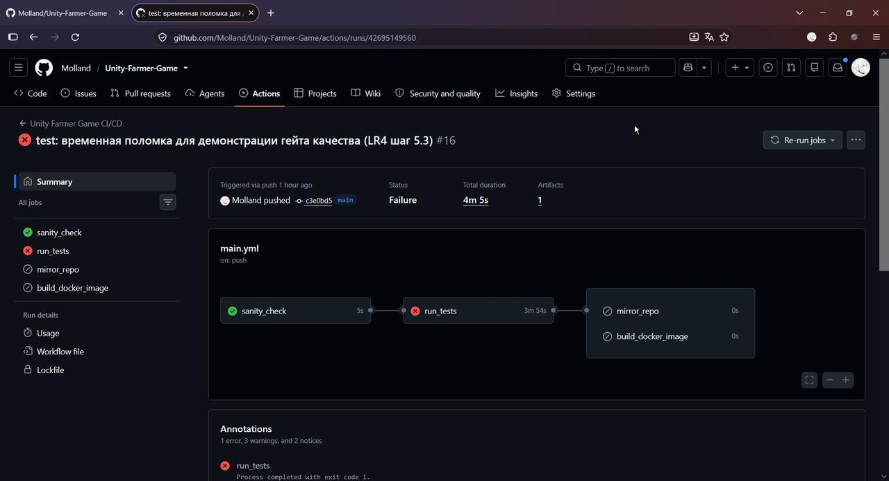

# Лабораторная работа №4: Автоматизация тестирования (Unity Test Runner) в CI/CD

**ФИО:** Шмат А.Д.  
**Группа:** 23-СТ  
**Индивидуальный вариант:** №19  
**Проверяемая механика:** `PlayerDeath` — при нулевом здоровье планируется событие `PlayerDeath` (тип теста — PlayMode)

---

## Шаг 1 — Разделение кодовой базы (Assembly Definitions)

Кодовая база разделена на три изолированных модуля. В корне папки с кодом игры (`Assets/HappyHarvest/`) создан файл `GameAssembly.asmdef` (игровой код), в `Assets/Tests/EditMode/` — `Tests.asmdef` (с `includePlatforms: ["Editor"]`, т.е. только EditMode), в `Assets/Tests/PlayMode/` — `PlayModeTests.asmdef` (без ограничения платформ, т.е. PlayMode). Обе тестовые сборки ссылаются на `GameAssembly`, поэтому тесты «видят» скрипты игры, но сами в финальную сборку не попадают (define constraint `UNITY_INCLUDE_TESTS`).

Так как код игры теперь компилируется в отдельную сборку, в `GameAssembly.asmdef` пришлось явно перечислить ссылки на пакеты, которые раньше подключались автоматически через `Assembly-CSharp`:

```json
{
    "name": "GameAssembly",
    "rootNamespace": "HappyHarvest",
    "references": [
        "Unity.Cinemachine",
        "Unity.RenderPipelines.Universal.Runtime",
        "Unity.RenderPipelines.Universal.2D.Runtime",
        "Unity.InputSystem",
        "Unity.2D.Tilemap.Extras"
    ],
    ...
}
```

Итоговая структура тестов:

```text
Assets/
├── HappyHarvest/
│   ├── GameAssembly.asmdef          # игровая сборка (скрипты игры)
│   └── Scripts/
│       └── Health.cs                # механика здоровья + событие PlayerDeath
└── Tests/
    ├── EditMode/
    │   ├── Tests.asmdef             # includePlatforms: ["Editor"] → тесты EditMode
    │   └── PlayerTests.cs
    └── PlayMode/
        ├── PlayModeTests.asmdef     # includePlatforms не указан → тесты PlayMode
        ├── PlayerHealthTests.cs
        └── PlayerDeathTests.cs      # тест по варианту №19
```

---

## Шаг 2 — Написание автоматических тестов

### Механика по варианту №19: `PlayerDeath`

Скрипт `Health.cs` реализует систему здоровья: `Awake()` выставляет `CurrentHP = maxHP`; метод `Decrement()` уменьшает HP на 1, и когда HP достигает нуля — **планируется событие `PlayerDeath`** (статическое событие `Action`, срабатывает ровно один раз при смерти):

```csharp
public void Decrement()
{
    if (!IsAlive) return;

    CurrentHP--;

    if (CurrentHP == 0)
    {
        PlayerDeath?.Invoke();
    }
}
```

### Тест по варианту №19: `PlayMode_PlayerDeath_EventPlannedAtZeroHealth`

Тест подписывается на событие `Health.PlayerDeath`, наносит урон живому персонажу и проверяет, что событие **не** планируется, пока HP > 0, и **планируется** ровно при достижении нуля:

```csharp
[UnityTest]
public IEnumerator PlayMode_PlayerDeath_EventPlannedAtZeroHealth()
{
    // Создаем временный объект с реальным скриптом здоровья из игры
    GameObject playerObj = new GameObject("TestPlayer");
    playerObj.SetActive(false);
    Health health = playerObj.AddComponent<Health>();

    health.maxHP = 2;
    playerObj.SetActive(true); // Awake выставит CurrentHP = maxHP = 2

    // Подписываемся на событие смерти игрока
    bool deathPlanned = false;
    void OnPlayerDeath() => deathPlanned = true;
    Health.PlayerDeath += OnPlayerDeath;

    // Пока здоровье больше нуля — событие смерти планироваться не должно
    health.Decrement();
    Assert.IsFalse(deathPlanned, "...");

    // При достижении нулевого здоровья должно планироваться событие PlayerDeath
    health.Decrement();
    Assert.IsTrue(deathPlanned, "...");

    // Отписываемся от события и удаляем объект после теста
    Health.PlayerDeath -= OnPlayerDeath;
    Object.Destroy(playerObj);
    yield return null;
}
```

### Базовые тесты

- **EditMode** — `EditMode_PlayerPrefab_IsConfiguredCorrectly` (`Assets/Tests/EditMode/PlayerTests.cs`): открывает префаб игрока `Character.prefab` и проверяет, что на нём присутствуют обязательные скрипты `PlayerController` и `Health`, а `maxHP > 0`.
- **PlayMode** — `PlayMode_PlayerTakesDamage_HealthDecreases` (`Assets/Tests/PlayMode/PlayerHealthTests.cs`): создаёт временный объект со скриптом `Health` (maxHP = 3) и проверяет, что после первого `Decrement()` персонаж жив, а после трёх уронов — мёртв (`IsAlive == false`).

### Локальный запуск в Test Runner

Оба режима прогнаны через Test Runner (Unity 6, `Window → General → Test Runner`), а также в batch-режиме из командной строки. Результаты (XML-отчёты Test Runner сохранены в `docs/lr4/`):

| Тест | Сборка | Результат |
|:-----|:-------|:----------|
| `EditMode_PlayerPrefab_IsConfiguredCorrectly` | Tests (EditMode) | ✅ Passed |
| `PlayMode_PlayerTakesDamage_HealthDecreases` | PlayModeTests | ✅ Passed |
| `PlayMode_PlayerDeath_EventPlannedAtZeroHealth` (вариант 19) | PlayModeTests | ✅ Passed |

Скриншот зелёного запуска Test Runner:





---

## Шаг 3 — Автоматический запуск тестов в GitHub Actions

В `.github/workflows/main.yml` добавлена задача `run_tests`: она ставит официальный CLI GameCI и запускает тесты обоих режимов сразу в контейнере `unityci/editor` (platforms `playmode;editmode;COMBINE_RESULTS`). Ключевые моменты:

- **Версия Unity передаётся явно** (`--engineVersion=6000.3.23f1`), так как `ProjectSettings/ProjectVersion.txt` исключён `.gitignore` и на раннере отсутствует.
- **Coverage отключён** (`--coverageEnabled=false`): инструментирование кода роняет Unity 6 в контейнере (SIGSEGV, exit code 139). Тесты запускаются прямым вызовом CLI, а не экшеном `game-ci/unity-test-runner@v4`, который формирует флаг `--no-coverageEnabled`, неведомый CLI v0.1.72.
- **Кэш папки `Library`** ускоряет повторные прогоны: импорт ассетов выполняется один раз.

```yaml
run_tests:
  needs: sanity_check
  runs-on: ubuntu-latest
  steps:
    - name: Checkout code
      uses: actions/checkout@v4
      with:
        lfs: true

    - uses: actions/cache@v4
      with:
        path: Library
        key: Library-${{ hashFiles('Packages/packages-lock.json', 'Assets/**/*.asmdef') }}

    - name: Install GameCI CLI
      run: |
        curl -sL -o game-ci.tar.gz https://github.com/game-ci/cli/releases/download/v0.1.72/game-ci-linux-x64.tar.gz
        tar xzf game-ci.tar.gz ./game-ci
        echo "$PWD" >> $GITHUB_PATH

    - name: Run Unity Tests
      run: |
        game-ci test --docker --dockerShmSize=1025m \
          --engine=unity --testPlatforms='playmode;editmode;COMBINE_RESULTS' \
          --engineVersion=6000.3.23f1 --coverageEnabled=false \
          --artifactsPath=artifacts --dockerIsolationMode=default \
          --containerRegistryRepository=unityci/editor \
          --containerRegistryImageVersion=3
      env:
        UNITY_LICENSE: ${{ secrets.UNITY_LICENSE }}
        UNITY_EMAIL: ${{ secrets.UNITY_EMAIL }}
        UNITY_PASSWORD: ${{ secrets.UNITY_PASSWORD }}

    - name: Upload test artifacts
      uses: actions/upload-artifact@v4
      if: always()
      with:
        name: test-results
        path: artifacts/
```

### Тесты как гейт качества

Цепочка задач перестроена через `needs:` — теперь она выглядит так:

```text
sanity_check → run_tests → mirror_repo
                         → build_docker_image
```

Задача `mirror_repo` и задача `build_docker_image` имеют `needs: run_tests`, поэтому при падении хотя бы одного теста они даже не запускаются — сломанный коммит автоматически блокируется и не доходит до зеркалирования и сборки Docker-образа.

Скриншот зелёного прогона Actions (цепочка `sanity_check → run_tests → build_docker_image`): 

---

## Шаг 4 — Безопасное добавление лицензии Unity

Для активации Unity Personal на облачном раннере в репозитории (`Settings → Secrets and variables → Actions`) созданы три секрета:

| Секрет | Содержимое |
|:-------|:-----------|
| `UNITY_LICENSE` | всё содержимое файла `Unity_lic.ulf` (многострочно, вместе с тегами Root) |
| `UNITY_EMAIL` | email аккаунта Unity |
| `UNITY_PASSWORD` | пароль аккаунта Unity |

Требования к аккаунту: вход по email/паролю (не через Google), 2FA отключена — в headless-режиме ввести второй фактор невозможно.

---

## Шаг 5 — Результаты и проверка гейта

1. Задача `run_tests` зелёная, в логе видны результаты обоих режимов, артефакт `test-results` с XML-отчётами сохранён даже при падении (`if: always()`).
2. Папка `Assets/Tests` с тестами и тремя `.asmdef` закоммичена в репозиторий.
3. **Демонстрация гейта:** во временном коммите тест заменён на заведомо ломающий (`Assert.AreEqual(1, 2)`). Прогон показал: `run_tests` — красная, задачи `mirror_repo` и `build_docker_image` — не запускались (заблокированы `needs:`). Коммит с поломкой удалён, тесты возвращены в рабочий вид.

Скриншот красного прогона (тест заблокировал сборку — `mirror_repo` и `build_docker_image` получили статус Skipped, 0s): 

---
