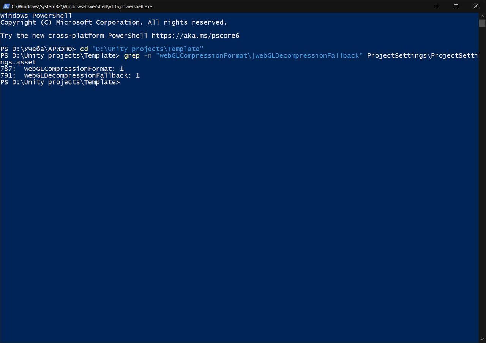
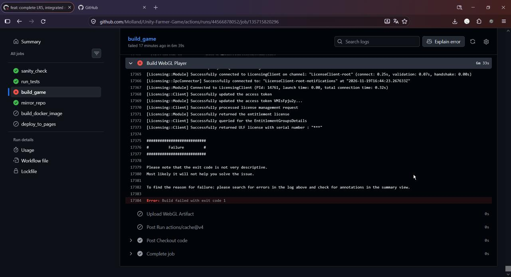
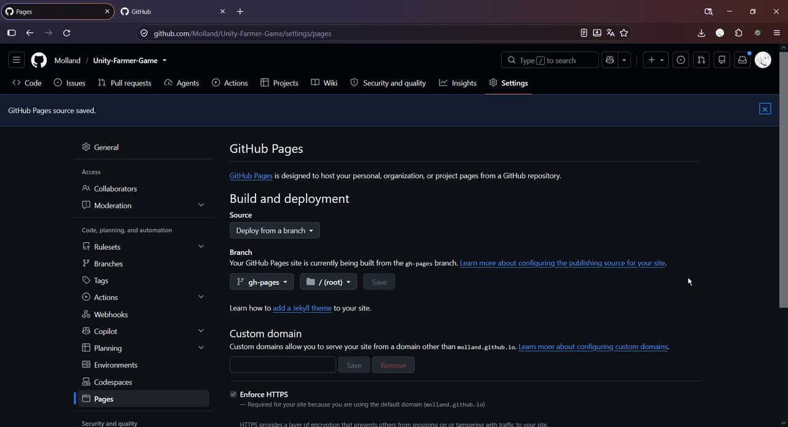
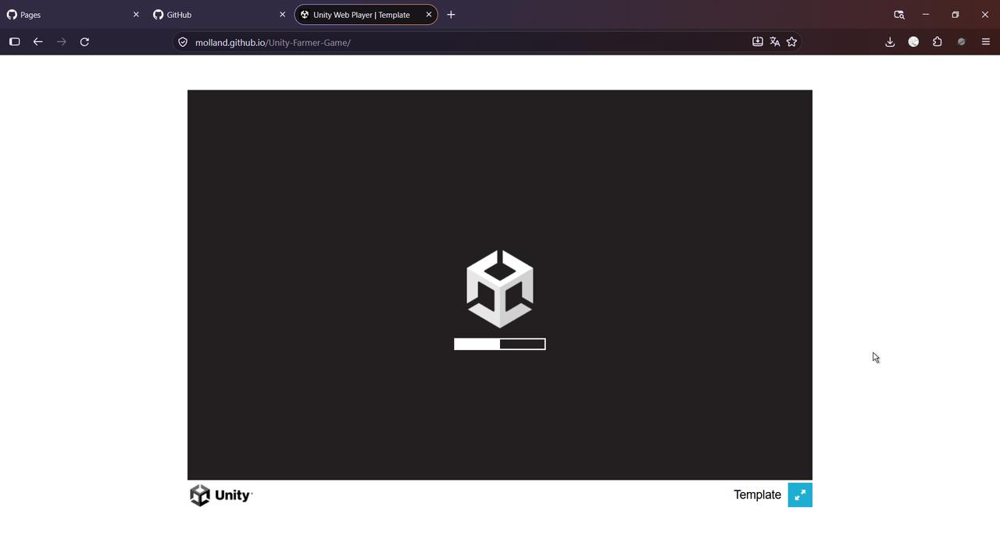
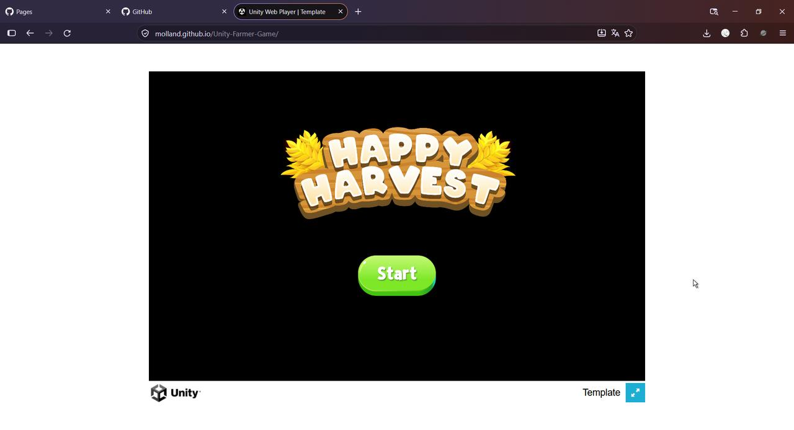
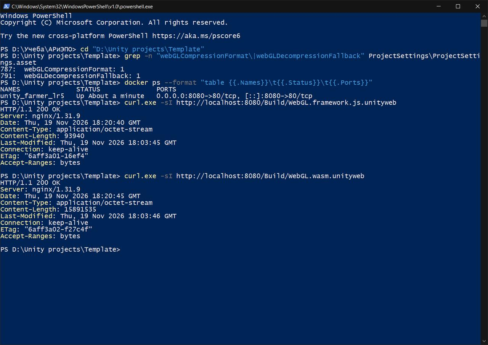

# Лабораторная работа №5: Автоматическая компиляция WebGL-игры в облаке и деплой на GitHub Pages

**ФИО:** Шмат А.Д.  
**Группа:** 23-СТ

---

## Шаг 1 — Подготовка Unity 6 к деплою на GitHub Pages

GitHub Pages не отправляет заголовок `Content-Encoding` для предсжатых файлов, поэтому для веб-сборки включена **резервная декомпрессия (Decompression Fallback)**: Unity внедряет в билд JS-распаковщик, и сжатые файлы распаковываются на стороне клиента без поддержки со стороны сервера. Формат сжатия оставлен **Gzip** (в ЛР №3 под него настроены правила Nginx).

Параметры зафиксированы в `ProjectSettings/ProjectSettings.asset` и проверены командой из методички:

```console
$ grep -n "webGLCompressionFormat\|webGLDecompressionFallback" ProjectSettings/ProjectSettings.asset
787:  webGLCompressionFormat: 1
791:  webGLDecompressionFallback: 1
```

**Замечание по нумерации значений.** В методичке ожидается «`webGLCompressionFormat: 0` (Gzip)», однако фактическая сериализация в файле иная: `0` — Brotli, `1` — Gzip, `2` — Disabled. Это подтверждается историей репозитория (в ЛР №3 формат Gzip выбирался в UI редактора, и в файле появилось значение `1`, сборка ЛР №3 содержала файлы `.gz`) и бинарной сигнатурой собранного файла: при значении `0` контейнер сборки содержал строку `UnityWeb Compressed Content (brotli)`, после исправления на `1` — Gzip-магию `1f 8b` в заголовке файла. Итоговое значение — **Gzip (`1`)**.

### Скриншот — Проверка параметров Publishing Settings



---

## Шаг 2 — Модернизация облачного пайплайна (задачи Build и Deploy)

В `.github/workflows/main.yml` пайплайн дополнен до шести задач; итоговая цепочка зависимостей:

```text
sanity_check → run_tests → build_game → build_docker_image
                                      → deploy_to_pages
                         → mirror_repo
```

### Новая задача `build_game` — настоящая компиляция игры в облаке

Задача стартует **только после успешных тестов** (`needs: run_tests`). Компиляцию выполняет официальный инструмент `game-ci/unity-builder@v4` в контейнере `unityci/editor:ubuntu-6000.3.23f1-webgl-3`:

```yaml
  # ЗАДАЧА 3 (ЛР №5): Настоящая компиляция игры в облаке
  build_game:
    needs: run_tests # Запустится только если тесты из ЛР №4 прошли успешно!
    if: github.repository == 'Molland/Unity-Farmer-Game' # Тяжелую сборку не гоняем в зеркале-backup
    runs-on: ubuntu-latest
    outputs:
      build_status: ${{ job.status }}
    steps:
      - name: Checkout code
        uses: actions/checkout@v4
        with:
          lfs: true

      # Кэшируем Library, чтобы компиляция не шла вечность
      - uses: actions/cache@v4
        with:
          path: Library
          key: Library-Build-${{ hashFiles('Packages/packages-lock.json', 'Assets/**/*.asmdef') }}

      # Вызываем облачный компилятор Unity 6 от GameCI
      - name: Build WebGL Player
        uses: game-ci/unity-builder@v4
        env:
          UNITY_LICENSE: ${{ secrets.UNITY_LICENSE }}
          UNITY_EMAIL: ${{ secrets.UNITY_EMAIL }}
          UNITY_PASSWORD: ${{ secrets.UNITY_PASSWORD }}
        with:
          targetPlatform: WebGL
          buildMethod: BuildManager.BuildWebGL # Вызов C# метода автоматизации из ЛР №1!
          unityVersion: 6000.3.23f1 # Версия указана явно: ProjectVersion.txt закрыт .gitignore
          dockerShmSize: 1025m

      # Сохраняем НАСТОЯЩИЕ скомпилированные файлы во временное облачное хранилище
      - name: Upload WebGL Artifact
        uses: actions/upload-artifact@v4
        with:
          name: WebGL-Build
          path: Builds/WebGL
```

Ключевые моменты: сборка выполняется методом `BuildManager.BuildWebGL` из ЛР №1 (результат виден пайплайну благодаря `EditorApplication.Exit` в batch-режиме), версия Unity задана явно `6000.3.23f1`, лицензия активируется по секретам `UNITY_LICENSE/UNITY_EMAIL/UNITY_PASSWORD`. Отдельный ключ кэша `Library-Build-…` (вместо тестового `Library-…`) ускоряет повторные сборки.

### Задача `build_docker_image` — живой билд вместо заглушек

Генерация фейковых файлов через `touch` из ЛР №3 удалена: вместо неё задача скачивает скомпилированный билд из артефакта `WebGL-Build` и уже зависит от `build_game`:

```yaml
  build_docker_image:
    needs: build_game # Теперь ждем полноценного билда игры!
    ...
    steps:
      - name: Download WebGL Artifact
        uses: actions/download-artifact@v4
        with:
          name: WebGL-Build
          path: Builds/WebGL
      # далее — публикация в GHCR (ghcr.io/molland/unity-farmer-game:latest и :${{ github.sha }})
```

### Новая задача `deploy_to_pages` — публикация на GitHub Pages

```yaml
  # ЗАДАЧА 6 (ЛР №5): Автоматический деплой игры на GitHub Pages
  deploy_to_pages:
    needs: build_game
    if: github.repository == 'Molland/Unity-Farmer-Game'
    runs-on: ubuntu-latest
    permissions:
      contents: write # Публикация в ветку gh-pages требует прав на запись
    steps:
      - name: Download WebGL Artifact
        uses: actions/download-artifact@v4
        with:
          name: WebGL-Build
          path: Builds/WebGL

      - name: Deploy to GitHub Pages
        uses: JamesIves/github-pages-deploy-action@v4
        with:
          folder: Builds/WebGL
          branch: gh-pages # Ветка для хостинга страниц
```

---

## Шаг 3 — Отладка первого прогона и запуск в облаке

Пайплайн отправлен в репозиторий коммитами `eb33a2a` (новые задачи build_game / docker / pages). Первый прогон №21 выявил **реальную ошибку, существовавшую в проекте со времён ЛР №4**: задача `build_game` упала со статусом «Build failed with exit code 1».

### Скриншот — Красный прогон: build_game заблокировал docker и pages (Skipped)



Диагностика по полному логу задания показала ошибки компиляции:

```text
## Script Compilation Error for: Csc Library/Bee/artifacts/2000b0aP.dag/GameAssembly.dll
Assets/HappyHarvest/ReadMe/Editor/BuildManager.cs(3,19): error CS0234: The type or namespace
name 'Build' does not exist in the namespace 'UnityEditor'
Assets/HappyHarvest/ReadMe/Editor/ReadmeTopBar.cs(10,29): error CS0246: The type or namespace
name 'Editor' could not be found
...
```

**Причина:** редакторские скрипты (`BuildManager.cs`, `ReadmeTopBar.cs`, `WelcomeInspectorEditor.cs`) компилировались в runtime-сборку `GameAssembly.dll` для WebGL-платформы, где API `UnityEditor` недоступно. В ЛР №4 папки `…/Editor/` были помечены `.asmref`-файлами со ссылкой `Unity.EditorAssemblies`, но в Unity 6 эта ссылка не резолвится — в логе сборки присутствует предупреждение `Assembly reference … has no target assembly definition`, и скрипты «проваливаются» в ближайшую asmdef-сборку. В редакторе это незаметно (там `UnityEditor` всегда доступен), поэтому тесты ЛР №4 были зелёными — сломался именно player-билд.

**Исправление** (коммит `e2dcda4`): неработающие `.asmref` заменены на полноценные editor-only `.asmdef` (`HappyHarvest.ReadMe.Editor`, `HappyHarvest.Scripts.Editor` — `includePlatforms: ["Editor"]` со ссылкой на `GameAssembly`), а в `WeatherSystem.cs` использование `UnityEditor` обёрнуто в `#if UNITY_EDITOR` (аналогичная проблема «в засаде»).

После исправления прогон №22 прошёл полностью зелёным. Второй найденный нюанс — сборка вышла в Brotli (см. замечание в Шаге 1: методичка даёт неверное значение сериализации); коммит `49d554f` исправил формат на Gzip, и итоговый прогон №23 завершился успешно. В логе `build_game` присутствует строка из метода `BuildWebGL` ЛР №1:

```text
[CI/CD] Запущен автоматический процесс сборки WebGL...
[CI/CD] УСПЕХ! WebGL билд успешно создан.
[CI/CD] Время сборки: 29.97 сек. Размер: 35575968 байт.
```

Первый прогон с холодным кэшем выполнял импорт ассетов ~33 минуты; после прогрева кэша `Library-Build` компиляция занимает ~30 секунд (весь шаг build_game — около 4 минут).

---

## Шаг 4 — Включение GitHub Pages в настройках репозитория

Хостинг включён однократно вручную: `Settings → Pages → Build and deployment → Source: Deploy from a branch → Branch: gh-pages, Folder: / (root) → Save`. После сохранения появилась плашка «GitHub Pages source saved» и статус «site is currently being built from the gh-pages branch».

### Скриншот — Включение GitHub Pages (gh-pages, /root)



---

## Шаг 5 — Проверка результатов

### 5.1. Все задачи пайплайна зелёные, деплой в ветку gh-pages

Прогон №23: `sanity_check → run_tests → build_game → build_docker_image / deploy_to_pages` — все зелёные. Ветвь `gh-pages` содержит настоящий билд: `index.html`, папки `Build/`, `StreamingAssets/`, `TemplateData/`; внутри `Build/` — файлы `WebGL.data.unityweb`, `WebGL.framework.js.unityweb`, `WebGL.wasm.unityweb`, `WebGL.loader.js` (несжатый). Артефакт `WebGL-Build` (≈35,6 МБ) идентичен содержимому ветки.

**Замечание:** при включённом Decompression Fallback Unity 6 собирает файлы с расширением `.unityweb` (а не `.gz`, как в тексте методички) — это собственный контейнерный формат Unity для сборок, которые должны работать на любом статическом хостинге без заголовков `Content-Encoding`. Внутреннее сжатие — Gzip (проверено сигнатурой `1f 8b`). Именно поэтому игра одинаково работает и на Pages, и в Docker-образе, а правила Nginx из ЛР №3 для `.gz`-файлов остаются в конфигурации, но в новой сборке не задействуются.

### 5.2. Игра работает на GitHub Pages

Открыт адрес <https://molland.github.io/Unity-Farmer-Game/>. Unity загружается со штатной полосой прогресса, после чего отображается главное меню игры Happy Harvest — WebGL-сборка работает на бесплатном статическом хостинге без какого-либо серверного конфигурирования (Decompression Fallback из Шага 1).

### Скриншот — Полоса загрузки Unity на GitHub Pages



### Скриншот — Главное меню Happy Harvest на GitHub Pages



### 5.3. Файлы билда отдаются с кодом 200

Все ресурсы игры запрашиваются с кодом 200, ошибок распаковки в консоли нет — это подтверждает работу встроенного JS-распаковщика (Decompression Fallback). Проверка заголовков:

```console
$ curl -sI https://molland.github.io/Unity-Farmer-Game/Build/WebGL.framework.js.unityweb
HTTP/1.1 200 OK
Content-Type: application/vnd.unity
Content-Length: 93940
```

### 5.4. Docker-образ с живой игрой в GHCR

Пакет `unity-farmer-game` опубликован в реестре GHCR под тегами `latest` и `49d554f` (хеш последнего коммита — позволяет откатиться на конкретную сборку командой `docker run ghcr.io/molland/unity-farmer-game:49d554f…`). Локальная проверка образа:

```console
$ docker pull ghcr.io/molland/unity-farmer-game:latest
Status: Downloaded newer image for ghcr.io/molland/unity-farmer-game:latest

$ docker run -d -p 8080:80 --name unity_farmer_lr5 ghcr.io/molland/unity-farmer-game:latest
c17532c3c3fc...

$ docker ps
NAMES              STATUS         PORTS
unity_farmer_lr5   Up            0.0.0.0:8080->80/tcp

$ curl.exe -sI http://localhost:8080/Build/WebGL.framework.js.unityweb
HTTP/1.1 200 OK
Server: nginx/1.31.9
Content-Type: application/octet-stream
Content-Length: 93940
```

Файлы `.unityweb` отдаются Nginx «как есть» (без `Content-Encoding: gzip`) — распаковку выполняет внедрённый в билд JS-распаковщик, поэтому игра работает по адресу <http://localhost:8080> без изменений в `nginx.conf`. Проверка из методички `curl -I … /Build/<файл>.js.gz` для этой конфигурации неприменима: файлов `.gz` в сборке с Decompression Fallback нет.

### Скриншот — Локальный запуск Docker-образа и проверка ответов



---

## Контрольные вопросы

1. **Почему папка Builds/WebGL закрыта .gitignore и как файлы попадают в задачи?** Собранные файлы — результат генерации, а не исходный код: держать их в Git бессмысленно (пересоздаются каждым билдом, шумят в истории, увеличивают репозиторий). Вместо Git они передаются между задачами через артефакты Actions: `build_game` загружает `Builds/WebGL` в артефакт `WebGL-Build` (upload-artifact), а `build_docker_image` и `deploy_to_pages` скачивают его (download-artifact) в ту же папку, заменяя заглушки из ЛР №3.

2. **Зачем build_game указывать needs: run_tests и что будет при падении тестов?** `needs` ставит компиляцию в зависимость от тестов: сломанный коммит не тратит дорогие минуты облачной сборки. Если тесты падают, `build_game`, `build_docker_image` и `deploy_to_pages` даже не стартуют (Skipped) — это продемонстрировано прогоном №21 на скриншоте выше.

3. **Роль метода BuildManager.BuildWebGL и почему результат виден пайплайну?** Метод из ЛР №1 собирает список активных сцен из EditorBuildSettings, вызывает `BuildPipeline.BuildPlayer` для WebGL и анализирует `BuildReport`. При batch-запуске (флаг `-batchmode`) он завершает редактор через `EditorApplication.Exit(0/1)`, превращая результат сборки в код возврата процесса Unity — именно этот код читает unity-builder, поэтому пайплайн видит успех или падение.

4. **Почему Pages требует Decompression Fallback, а Docker-образ с Nginx обходится без неё?** GitHub Pages — статический хостинг без возможности настроить заголовки: он не отправит `Content-Encoding: gzip` для предсжатого файла, и браузер не распакует его сам. Fallback решает это: JS-распаковщик встроен в билд. В Docker-образе свой Nginx, где заголовки настраиваются (`add_header Content-Encoding gzip` из ЛР №3), поэтому там достаточно «чистых» файлов — впрочем, с fallback билд (`*.unityweb`) работает на обоих хостингах одинаково, что и показано в работе.

5. **Чем отличаются Pages и Docker-образ в GHCR и зачем теги latest и github.sha?** Pages — бесплатный статический хостинг «для просмотра»: всегда раздаёт последний успешный билд, без окружения и откатов. Docker-образ — переносимый артефакт доставки: запускается на любом сервере с Docker (`docker run -p 80:80 ghcr.io/molland/unity-farmer-game:latest`). Тег `latest` указывает на последнюю сборку, тег `${{ github.sha }}` — на билд конкретного коммита: это позволяет зафиксировать/откатиться на любую рабочую версию и понять, какой коммит опубликован.

6. **Почему при успешном deploy_to_pages сайт может отдавать 404?** Задача лишь публикует файлы в служебную ветку `gh-pages`, но не включает сам хостинг. Пока Pages не активирован вручную (Settings → Pages → Deploy from a branch → gh-pages / root), ссылка `https://molland.github.io/…` отдаёт 404 даже при зелёном пайплайне. После однократной активации все последующие билды публикуются автоматически.

---
